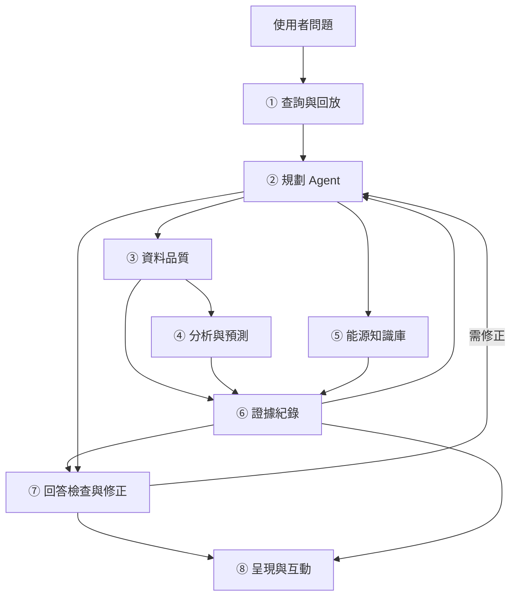
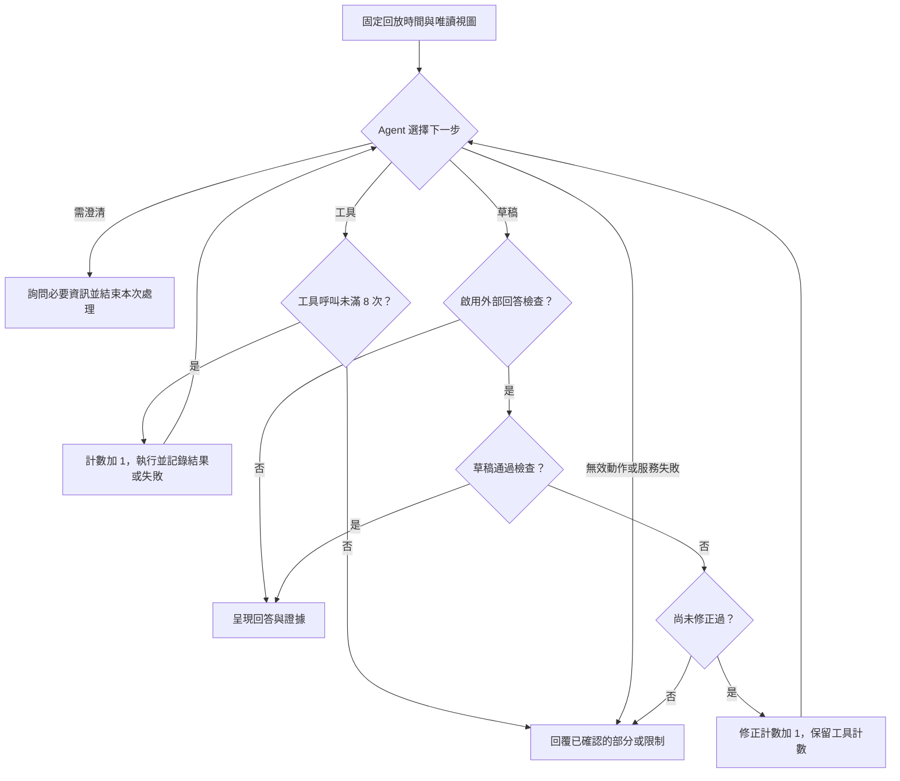

# Energy Detective 系統設計

## 1. 問題與範圍

家庭用電問題涉及不同時間區間、資料覆蓋率與單位。Agent 以 UCI 單一家庭歷史資料回放為分析基礎，回覆查詢、比較、異常、預測與建議，並讓讀者從證據追查結論。此文件為實作與驗證計畫摘要，依[正式 Word](https://github.com/lun-09-15/AIoT_Final_Proj/blob/main/deliverables/Energy_Detective_Proposal.docx) §5–6 與[正式簡報](https://github.com/lun-09-15/AIoT_Final_Proj/blob/main/deliverables/Energy_Detective_Proposal.pptx)第 10–18 頁整理。

| 任務 | 輸出 | 資料限制 |
| --- | --- | --- |
| 查詢 | 指定期間電量、單位、資料覆蓋率 | 資料不足時說明可用範圍 |
| 比較 | 兩區間電量、差值與可比較條件 | 比較前確認期間長度與資料覆蓋率 |
| 異常 | 偏離基準的時間點、數值與規則 | MAD 只支持候選標記，設備或原因需額外證據 |
| 預測 | 下一小時電量、預測起點與基準 | 特徵只使用預測當下已知的資料 |
| 建議 | 可採行的節能做法、依據與適用限制 | 歷史單戶資料無法直接證明實際節電量 |

## 2. 系統架構



| 模組 | 責任 |
| --- | --- |
| ① 查詢與回放 | 接收問題、設定回放時間、解析查詢期間 |
| ② 規劃 Agent | Cloud LLM 判斷任務類型、選擇工具、依結果組織回答 |
| ③ 資料品質 | 檢查時間範圍、資料粒度、缺值與覆蓋率 |
| ④ 分析與預測 | 執行電量統計、區間比較、MAD 異常標記與 Random Forest 預測 |
| ⑤ 能源知識庫 | 提供規劃中的約 10 條可追溯知識，紀錄來源與適用條件 |
| ⑥ 證據紀錄 | 儲存工具輸入、輸出、資料區間、單位與知識來源 |
| ⑦ 回答檢查與修正 | 對照回答與證據，必要時修正一次並複查 |
| ⑧ 呈現與互動 | Streamlit 呈現答案、圖表、證據與限制 |

## 3. 處理流程



失敗呼叫也計入 8 次上限。修正時可重新規劃並使用剩餘的工具呼叫額度，也可使用現有證據修正文句。工具、服務或檢查失敗時，保留可確認結果並說明限制。

## 4. 資料與分析方法

- **回放**：UCI 法國單戶歷史資料以原始記錄時鐘建立小時格網。回放截至時間為小時邊界 `h`，唯讀視圖只提供時間戳小於 `h` 的實際觀測。下一小時目標為 `[h,h+1)`。
- **電量與資料品質**：全屋分鐘平均功率（kW）以 `Σ(Pᵢ/60)` 換算成 kWh；設備群每分鐘電量（Wh）以 `Σ(eᵢ)/1000` 換算成 kWh。依查詢欄位檢查資料，完整小時須有 60 個不同分鐘的有效紀錄。相同紀錄去重，衝突紀錄標為無效。初版不補值；不完整區間回報已觀測電量、涵蓋率與限制，無有效紀錄時回覆資料不足。完整日按原始日期格網檢查，基準為零時只報絕對差。
- **下一小時預測**：Random Forest 初始設定為 `n_estimators=200`、`max_depth=12`、`min_samples_leaf=5`、`random_state=42`。特徵包括 lag 1／2／24／168、過去 3／24 小時的平均與標準差及已知日曆特徵。模型訓練截止須不晚於 `h`，所需歷史資料須完整。RF 不可用時，可回傳清楚標示的 Persistence（上一完整小時）或 Daily Seasonal Naive（前一天同時段）。
- **異常候選**：對完整且可見的目標小時，取此前 56 天的同時刻、同日型（平日／週末）完整紀錄，至少 14 筆。初版以修正 Z 分數絕對值大於 3.5 標記候選。樣本不足時說明限制，MAD 為零時只呈現可核對差異。故障與浪費成因須另外查證。
- **知識與證據**：規劃約 10 條知識，每條含來源及適用條件。紀錄工具參數、版本、狀態及結果 ID。回答檢查核對必要欄位、數字、時間、單位、增減方向、引用、圖表 ID 與明確限制，建議合理性仍須人工評估。

## 5. 虛擬碼

下列為正式 Word §5.5 的摘要。Algorithm 1 另標出 A/B 評估的檢查開關，對應正式 Word §6.2。

### Algorithm 1 Agent 主迴圈與驗證控制

```text
01  固定回放時間、唯讀資料視圖、模型及知識版本
02  初始化證據紀錄、工具計數、修正計數與檢查問題
03  規劃下一步，動作分為澄清、工具、草稿或錯誤
04  若需澄清，詢問必要資訊並結束本次處理
05  若要執行工具且已達 8 次，回傳已確認的部分或限制
06  若要執行工具且仍有額度，計數加 1，再執行工具
07  記錄參數、來源、結果或失敗，回到步驟 03
08  若動作無效或服務失敗，回傳已確認的部分或限制
09  將草稿綁定至存在的證據 ID
10  條件 A 直接輸出草稿並保留證據紀錄供離線評估
11  條件 B 核對草稿，通過時輸出回答與證據
12  若未通過且已修正過，回傳已確認的部分或限制
13  否則增加修正計數，把檢查問題交回步驟 03，保留工具計數
```

### Algorithm 2 完整性檢查與電量統計

```text
01  確認查詢區間有效、非空，且結束時間不晚於回放時點
02  依原始時鐘建立預期分鐘格網，去除完全相同的重複列
03  按欄位選取有效且無衝突的分鐘值，無有效值時回傳資料不足
04  計算涵蓋率 = 有效分鐘數 / 預期分鐘數
05  全屋以 Σ(分鐘平均 kW / 60) 計算 kWh
06  設備群以 Σ(分鐘 Wh) / 1000 計算 kWh
07  依格網是否完整標為完整或部分觀測，回傳電量、區間與涵蓋率
```

### Algorithm 3 下一小時預測與基準回退

```text
01  取得回放時點前可見的完整小時紀錄
02  有上一小時電量時加入 Persistence 估計
03  有前一天同時段電量時加入 Daily Seasonal Naive 估計
04  若 RF 不可用或訓練截止晚於 h，回傳已標示的基準或限制
05  建立歷史 lag、滾動統計與已知日曆特徵
06  若必要特徵缺失，回傳已標示的基準或限制
07  執行 RF 並記錄模型版本、預測結果或失敗
08  回傳各項估計、限制及目標區間 [h,h+1)，單位 kWh
```

### Algorithm 4 MAD 異常候選標記

```text
01  目標小時須完整且可見，否則回傳限制
02  選出此前 56 天同時刻且同日型的完整小時，排除目標小時
03  參考數量不足 14 筆時，回傳參考資料不足
04  計算參考電量中位數 m 與絕對偏差中位數 MAD
05  MAD 為零時回傳可核對差異與限制
06  計算修正 Z 分數 = 0.6745 × (x − m) / MAD
07  分數絕對值 > 3.5 時標記異常候選
08  回傳分數、參考筆數與判定依據
```

## 6. 評估計畫

| 評估 | 設計 | 紀錄 |
| --- | --- | --- |
| 預測 | 先依完整時間格網切成 70%／15%／15%，再篩選可用樣本。逐小時回放，在三種方法共同可預測且真值完整的時點比較 | MAE、RMSE、各方法可用率與排除原因 |
| 異常候選 | 檢查計算、時間邊界、案例合理性與門檻敏感度 | 標記案例及無真實故障標籤的限制 |
| Agent A | 使用相同模型、工具、知識、資料、題目、格式與初始提示，關閉外部回答檢查與修正 | 保留證據紀錄供離線評估 |
| Agent B | 同 A，開啟外部回答檢查，最多修正一次，工具計數持續累計 | 另記錄修正次數及額外成本 |

獨立試測 10 題。正式 50 題涵蓋五類任務，每類 6 題一般、4 題邊界。每題每條件執行 3 次，共 300 次正式任務，回放時點位於最終測試區間。題目、預期答案與評分規則事前凍結。指標包括完成率、數字／單位／時間正確性、證據一致性、適當限制、不必要拒答、執行成本與穩定性。建議品質由兩位組員獨立評分，分別評估證據支持、推論界線、可採取性，每項 0–2 分。

## 7. 交付與限制

正式 Word 與 PPT 收錄於 [AIoT_Final_Proj](https://github.com/lun-09-15/AIoT_Final_Proj/tree/main/deliverables)。目前是提案階段，原型、模型訓練及正式評估待執行。單戶歷史資料用於驗證回放流程，跨家庭適用性、實際節電、省費與減碳效果須另行驗證。
