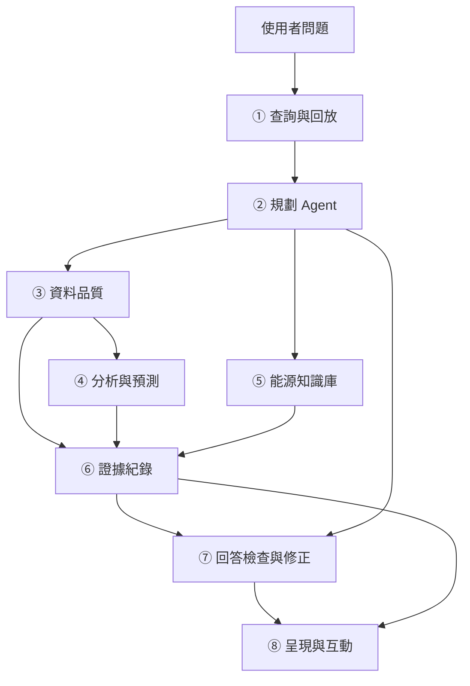
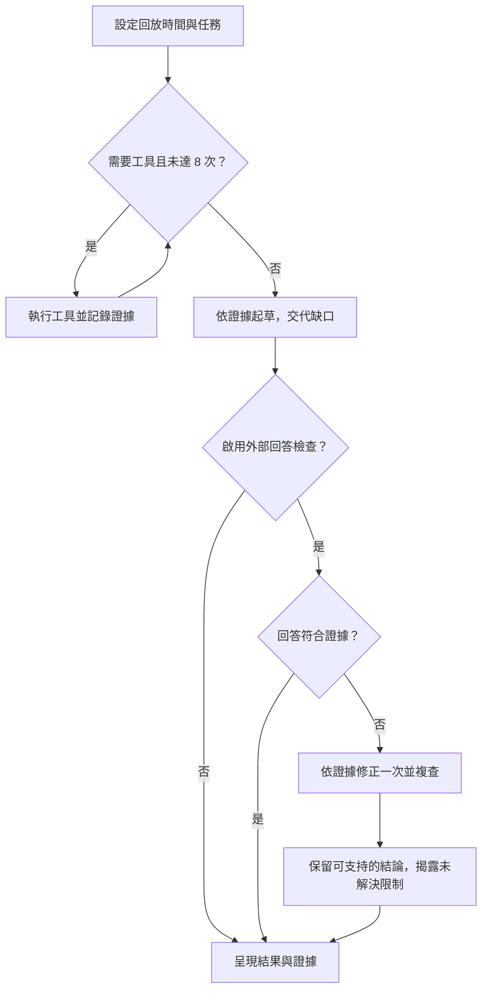

# Energy Detective 系統設計

## 1. 問題與範圍

家庭用電問題涉及不同時間區間、資料覆蓋率與單位。Agent 以 UCI 單一家庭歷史資料回放為分析基礎，回覆查詢、比較、異常、預測與建議，並讓讀者從證據追查結論。此文件是實作與驗證計畫。

| 任務 | 輸出 | 資料限制 |
| --- | --- | --- |
| 查詢 | 指定期間電量、單位、資料覆蓋率 | 資料不足時說明可用範圍 |
| 比較 | 兩區間電量、差值與可比較條件 | 比較前確認期間長度與資料覆蓋率 |
| 異常 | 偏離基準的時間點、數值與規則 | MAD 只支持候選標記，設備或原因需額外證據 |
| 預測 | 下一小時電量、預測起點與基準 | 特徵只使用預測當下已知的資料 |
| 建議 | 可採行的節能做法、依據與適用限制 | 歷史單戶資料無法直接證明實際節電量 |

## 2. 系統架構



| 模組 | 責任 |
| --- | --- |
| ① 查詢與回放 | 接收問題、設定回放時間、解析查詢期間 |
| ② 規劃 Agent | Cloud LLM 判斷任務類型、選擇工具、依結果組織回答 |
| ③ 資料品質 | 檢查時間範圍、資料粒度、缺值與覆蓋率 |
| ④ 分析與預測 | 執行電量統計、區間比較、MAD 異常標記與 Random Forest 預測 |
| ⑤ 能源知識庫 | 提供規劃中的 10 條可追溯知識，紀錄來源與適用條件 |
| ⑥ 證據紀錄 | 儲存工具輸入、輸出、資料區間、單位與知識來源 |
| ⑦ 回答檢查與修正 | 對照回答與證據，必要時修正一次並複查 |
| ⑧ 呈現與互動 | Streamlit 呈現答案、圖表、證據與限制 |

## 3. 處理流程



## 4. 資料與分析方法

- **電量與資料品質**：功率用 kW，電量用 kWh。對等間隔且代表區間平均功率的樣本，將各有效樣本乘以其區間小時數後加總。另記錄缺值、覆蓋率和統計範圍。最低覆蓋率門檻與補值政策待實作確認。
- **下一小時預測**：以依時間排序的 70%／15%／15% 訓練、驗證與測試切分。使用 Random Forest，並和上一小時 Persistence、前一天同時段 Daily Naive 比較。訓練及前處理參數由訓練資料取得，超參數選擇使用驗證資料，測試結果使用共同可評估的時間點。
- **異常候選**：以參考窗口中位數與 MAD 計算修正 Z 分數。參考窗口、門檻與最低有效樣本數待驗證。MAD 為零時記錄該規則無法判定。
- **知識與證據**：能源知識紀錄建議內容、來源及適用條件。回答檢查對照數值、單位、期間、來源、缺值與限制。證據不足的主張應省略或說明不確定性。

## 5. 虛擬碼

以下依提案解析重建，用於對齊設計和實作。涵蓋例外處理的步驟屬本次設計整理。

### Algorithm 1 Agent 主迴圈與驗證控制

```text
01  取得使用者問題、回放時間與是否啟用外部回答檢查
02  規劃任務、所需資料與工具
03  在仍需工具且總呼叫次數小於 8 時執行下一項工具
04  記錄工具參數、輸出、錯誤和證據來源，更新規劃並回到步驟 03
05  根據證據起草回答，標示資料或工具不足造成的缺口
06  若啟用外部回答檢查，比對數值、時間範圍、單位、來源與限制
07  如有可修正問題，根據現有證據修正一次並複查
08  若仍有無法驗證的主張，保留有證據的結論並揭露限制
09  回傳回答、證據與工具執行紀錄
```

### Algorithm 2 完整性檢查與電量統計

```text
01  依查詢時間、粒度及回放上限取出功率樣本
02  計算有效樣本數、預期樣本數與覆蓋率
03  若區間無有效樣本或覆蓋率低於設定，回傳資料不足及覆蓋率
04  以有效樣本功率乘區間長度後加總，將輸出標示為有效區間電量
05  回傳電量、單位、起訖時間、覆蓋率與計算規則
```

### Algorithm 3 下一小時預測與基準比較

```text
01  依時間建立小時電量及歷史特徵，每列以預測起點截斷可用資料
02  按目標時間進行 70/15/15 切分，在訓練集擬合、驗證集選擇參數
03  在測試集產生 Random Forest、上一小時與前一天同時段預測
04  在三種方法共同可評估的時間點計算 MAE 與 RMSE
05  記錄可評估筆數、排除條件、基準及兩個誤差指標
```

### Algorithm 4 MAD 異常候選標記

```text
01  依參考窗口取得有效用電樣本，檢查樣本數是否足夠
02  計算參考樣本的中位數 median 與絕對偏差的中位數 MAD
03  若樣本不足或 MAD 為零，回傳無法判定原因
04  對待判定值 x 計算 modified_z = 0.6745 × (x − median) / MAD
05  若 abs(modified_z) 大於門檻，標記異常候選
06  回傳時間、數值、分數、門檻與參考窗口
```

## 6. 評估計畫

| 評估 | 設計 | 紀錄 |
| --- | --- | --- |
| 預測 | Random Forest 對照 Persistence 和 Daily Naive | 測試集 MAE、RMSE、共同可評估樣本數 |
| Agent A | 關閉外部回答檢查 | 任務正確性、證據支持、限制揭露、耗時 |
| Agent B | 開啟外部回答檢查，最多修正一次 | 同 A，另記錄檢查與修正發生次數 |

兩條件使用相同 50 題（30 題一般、20 題邊界）、資料與回放時間。每題每條件執行三次，共 300 次任務。保留逐題紀錄，並依任務與題型彙整結果。各題的正確值、容許差異及證據判準在正式測試前固定。

## 7. 交付與限制

目前已整理提案規劃、解析、附件索引及設計。正式提案原稿與投影片待補；實作階段再加入資料取得、環境設定、執行方式、程式對照、題庫與實驗結果。單戶歷史資料可支援回放驗證，對不同家庭的適用性仍須另行測試。
